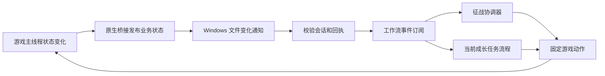

# 征战与成长的事件调度

征战、剧情和当前成长任务由状态事件唤醒。领域策略仍决定下一步动作；事件回调本身不直接发起战斗或培养。

每次明确开始任务，都先观察当前游戏页面并建立本轮内存状态。旧任务文件、历史失败计数和核对凭据不参与启动；本轮只有一个待确认动作，结果未知时停止本轮。日志作为诊断输出保留，日志写入失败只提示，不决定游戏动作。

如果本轮精确关联的原生回执为 `REJECTED`、`invoked=false`、`campaign_revision_changed`，协调器等待同一上下文的更高版本状态后重新规划，适用于确认奖励等全部征战动作。旧版本不再发令；连续版本冲突共用原来的等待预算。调用结果不明、上下文变化或用户已经暂停时不自动重发。

## 事件来源

Unity 主线程继续读取实际游戏对象。`Probe` 只在征战版本、养成版本、刷新状态或 GUI 调用阶段变化时主动发布状态；不需要由 Python 连续发送观察命令才能发现战斗结束。

Python 用 Windows 目录变化通知等待桥接文件更新，校验后交给对象服务。心跳和身份监控独立运行，不触发重复业务决策。

## 工作流事件

| 事件 | 作用 |
| --- | --- |
| `battle_settled` | 保留战斗结算事实，按会话、尝试和战报去重 |
| `story_changed` | 剧情、教学或战后阶段变化后重新决定下一步 |
| `growth_task_changed` | 当前任务要求、完成或领奖状态变化 |
| `equipment_changed` | 装备等级、费用或培养状态变化 |
| `connection_changed` | 连接变化、失效或关闭时唤醒并停止发令 |
| `state_changed` | 其他界面、版本和准入条件变化 |

每个订阅属于当前运行令牌，保存脱离原对象的快照。重复通知不会把同一战报重复计入胜败；仅采样时间和帧数变化不产生业务事件。暂停、继续、F8 和超时也会唤醒协调器。

每个实际发布的语义事件现在统一排队写入界面“运行日志”和 `data/logs/assistant.log`，包含事件序号、运行/会话、版本、关卡、阶段、准入原因及相应结算或成长状态。订阅重放不重复记一遍；命令另外记录 `admitted`、`reply`、`failed`，其中 ACK 回复不代表业务完成。征战模式、暂停和停止原因变化也单独记入日志。

页面与文件使用不同呈现：页面显示本次启动后的章节、敌军、动作、结果和停止原因的中文摘要；原始结构化事件、回执字段、身份及诊断信息写入文件。启动不读取历史日志；正常释放调用资源也不会显示成连接故障。

2026-10-31 第 87 章第 11 队停止时，游戏画面显示“小败”，但最终结算回执没有捕获、报告号为 0、目标进度没有增长，观察器因此保留 `UNKNOWN` 并阻断后续发起，连续失败数仍为 0。现有记录不能区分服务端接受的无报告败局与结算拒绝，未改写原记录或计数。证据和实际日志页面确认见 `data/acceptance/20261031-campaign/35-settlement-incident/`。

通知读取遇到 Windows 文件共享占用时，记录一次 `state_read_wait`，在最多 5 秒内以可停止的等待重读文件，恢复后记录 `state_read_resumed`。重读不会再次提交游戏命令。永久错误或超过期限仍会停止，并保留首次错误阶段、时间和系统错误码；后台错误不会再被清理路径覆盖成 `user_stop`。2026-10-31 的原始占用事件保存在 `data/acceptance/20261031-campaign/34-event-logs/incident.json`，持有不兼容句柄的进程尚未确定。

## 流程边界

征战启动时保留一次新鲜观察。之后等待事件并使用已校验的状态缓存，遇到剧情继续使用正常跳过流程。遇到成长提示时，调用一次 `current_growth_task`，完成当前项后回到征战；需要战斗才能满足的要求直接交还征战。

尚未发起动作的成长项若缺少执行器或功能未开放，且没有未决操作、地图仍可交互，会记一条待办日志并继续征战。只有相关任务要求或能力开放状态变化后才重新尝试。已发起动作后的未知结果、回包缺失和界面阻塞仍保留并暂停。

实际推进中遇到的“灵兽系统开放”“日常活动开放”属于单按钮功能介绍。固定流程只按正常“确定”分支关闭介绍并继续剧情，不进入或培养该功能。短动画、临时禁用输入及章末等待结算窗口的间隔只等待下一状态事件，不立即永久暂停。

`campaign_loading` 在地图、部队和布阵三个原生阶段都进入有时限的事件等待，不额外依赖地图动画标志。2026-10-31 实际推进曾因切章加载被误归为人工暂停；修正并重载后，已在部队、布阵加载时保持运行并推进至第 60 章第 4 队。事件记录见 `data/acceptance/20261031-campaign/32-current-task-flow/loading-pause.json`。

第 71 章还发现 `m_bPostInit=true` 会在游戏已可交互时残留：正常点击于吉能立即打开敌军信息。源码中 `PostInit` 的同步回调链可先恢复输入并清除此值，再被外层写回 `true`；正常 `wantCombat` 不检查它。因此桥接不再把该值当成选择阻断，仍保留输入、场景归属、角色和敌军校验；字段继续用于诊断，不修改游戏字段。其他确实拒绝且确认未调用的选择暂态才在新版本事件后重新规划。

装备或灵兽目标首次绑定时提交一次带目标的观察，后续等级和回执由事件推送。命令意图、关联回执、失败三次停止、暂停和停止规则继续由各自领域流程负责。

本次完成代码改造与程序构建。按当前约定，没有安排额外测试或审查；已领取的装备成长任务留待后续实际使用复测。

2026-10-31 15:20 的实际运行记录：事件通知启用，原生桥接处于 `ready`，征战已推进到第 58 章第 6 队，连续失败为 0；本轮仅发送一次 `campaign-observe`，后续状态变化驱动了 17 次正常征战动作。加载功能介绍处理后发现的 `ui_context.counts.function` 校验字段遗漏已补齐。观察快照见 `data/acceptance/20261031-campaign/32-current-task-flow/event-runtime-final.json`；这是一条实际运行记录，不代表已覆盖全部剧情和成长任务。
